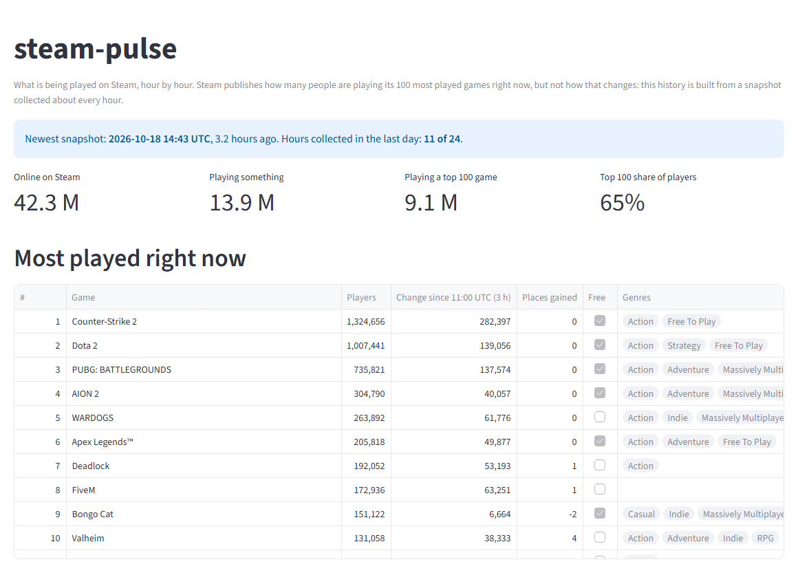
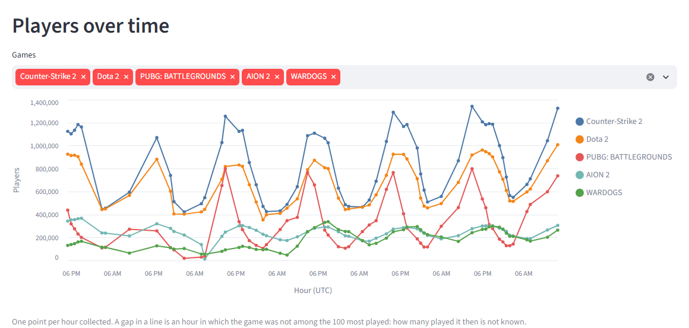
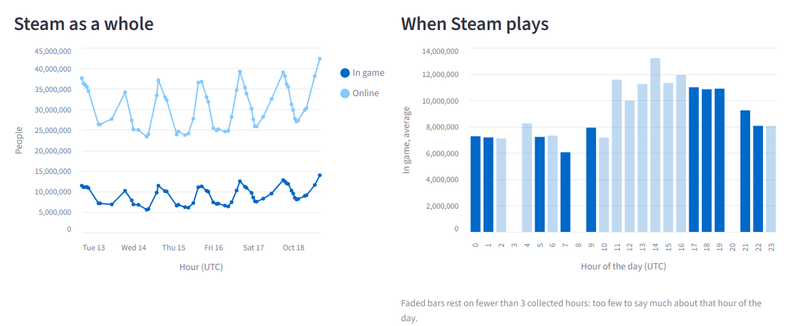

# steam-pulse

What is being played on Steam, hour by hour.

Steam publishes how many people are playing each of its 100 most played games *right
now*, but not how that changed over time. This project builds that history itself: it
takes a snapshot every hour, keeps it untouched, and turns the pile of snapshots into
tables and a dashboard.

> **Not affiliated with Valve.** This is a personal project. It is not endorsed by,
> sponsored by or affiliated with Valve Corporation or Steam. Steam and the Steam logo
> are trademarks of Valve Corporation. The data comes from public Steam endpoints and is
> offered as is, with no guarantee of accuracy. No data about individual Steam users is
> collected or stored: only public, aggregate counts.



## Status

| Stage | State |
|---|---|
| Hourly collection of raw snapshots | Running |
| Collection of the details of each game (name, genres, release date) | Running |
| Load of the raw snapshots into the warehouse | Working locally (DuckDB); cloud warehouse planned |
| Modelling with dbt | Hourly and daily tables, and a table of games with their names |
| Dashboard | Rebuilt after every collection; hosted on Streamlit Community Cloud |
| Data quality and freshness alerts | Freshness check running; data tests in every build |

## How the collection works

```
GitHub Actions (twice an hour)  ->  steam_pulse.collect  ->  commit on the `data` branch
```

- **Two runs an hour for one snapshot an hour.** GitHub does not guarantee scheduled
  runs: it delays them under load and may drop them. A hole in the history cannot be
  filled later, so the collection runs twice an hour and the models keep one snapshot
  per hour.
- **One request per snapshot.** A single Steam endpoint returns the 100 most played
  games with their player counts. A second request stores the total number of Steam
  users online and in game.
- **The data is dated by Steam, not by the collector.** The ranking carries the moment
  it was computed (`last_update`). Responses come through a cache and can be older than
  a previous one, so each snapshot is filed under that moment: collecting the same
  snapshot twice stores it once.
- **The details of a game are asked for once.** The ranking only carries numbers, so
  the name, type, genres and release date of each game come from the store, one request
  per game. After each snapshot, `steam_pulse.details` asks only for the games that have
  no details stored yet: all of them the first time, then the few that enter the
  ranking. The store publishes no limits, so requests go one at a time with a pause
  between them, there is a cap per run, and it stops at the first response that is not
  an answer about a game. A failure here never costs a snapshot.
- **Nothing is thrown away.** A response that does not look right (an error status, a
  maintenance page, a changed format) is kept under `raw/_rejected/`, and the run is
  marked as failed.
- **Raw data lives on its own branch.** `main` holds code and only changes through pull
  requests; the [`data`](../../tree/data) branch holds nothing but snapshots, one commit
  per collection. Everything downstream can be rebuilt from it.

```
raw/concurrent_players/date=2026-10-12/20261012T154904Z.json
raw/steam_users/date=2026-10-12/20261012T155449Z.json
raw/app_details/date=2026-10-13/730.json
raw/_rejected/<source>/date=.../....json
```

Each file is the response wrapped in an envelope:

```json
{
  "source": "concurrent_players",
  "url": "https://api.steampowered.com/ISteamChartsService/GetGamesByConcurrentPlayers/v1/",
  "collected_at": "2026-10-12T15:54:48Z",
  "http_status": 200,
  "payload": { "response": { "last_update": 1791820144, "ranks": [ ... ] } }
}
```

## How a stopped collection is noticed

```
GitHub Actions (every three hours)  ->  steam_pulse.freshness  ->  fails if the newest ranking is too old
```

- **A collection that stops does not fail.** A scheduled run that never starts reports
  nothing, so watching the runs is not enough. `steam_pulse.freshness` looks at the data:
  the newest ranking on the `data` branch, by the moment Steam computed it.
- **Twelve hours is the limit.** Scheduled runs have been seen up to 7.4 hours apart;
  past twelve, the collection has stopped. A failed run is what GitHub notifies about.
- **It shares the scheduler it watches.** If GitHub disables scheduled workflows (it does
  after 60 days without activity in the repository), this stops too. It catches a
  collection that keeps failing, is skipped for hours or stores stale answers; it does
  not catch the scheduler going away.

## How the load works

```
`data` branch (JSON files)  ->  steam_pulse.load  ->  raw.snapshots (one row per file)
```

- **The warehouse is disposable.** It holds nothing that is not in the snapshot files:
  delete it, run the load, and it is back.
- **The load only copies.** Each file becomes one row with its payload kept as JSON,
  rejected responses included. Turning that into players per game is left to the models.
- **Loading twice adds nothing.** A snapshot is identified by its source and its file
  name, so only the files that are not in the warehouse yet are read. A load that fails
  halfway leaves the warehouse as it was.
- **One code path, two warehouses.** `--database` takes a local DuckDB file or a
  MotherDuck database (`md:steam_pulse`).

## How the modelling works

```
raw.snapshots
  -> staging        stg_concurrent_players   one row per game and snapshot
                    stg_steam_users          one row per snapshot
                    stg_app_details          one row per game with store details
  -> intermediate   int_hourly_snapshots     the snapshot that stands for each hour
  -> marts          fct_game_hourly          one row per game and hour
                    fct_game_daily           one row per game and day
                    fct_platform_hourly      one row per hour, with the totals of Steam
                    fct_ranking_changes      games entering and leaving the ranking
                    dim_games                one row per game ever ranked, with its details
```

- **Staging only renames and types.** The ranking is unfolded into one row per game,
  `"38,882,059"` becomes a number, rejected responses are left out. No business logic yet.
- **The time of a row is the time of the data.** `snapshot_at` is the moment Steam says
  it computed the ranking; `collected_at` is kept next to it, so the age of the cached
  response can be measured.
- **Missing is not zero.** A game has rows only while it is in the ranking. Nothing
  fills the gaps with zeros, and a change is only computed against exactly one hour
  before: if that hour is not known, the change is null.
- **One snapshot per hour, chosen once.** Runs can be late, repeated or launched by
  hand. `int_hourly_snapshots` picks the last snapshot of each hour and every table
  builds on that choice.
- **Every game keeps its figures, details or not.** `dim_games` lists the games from
  the ranking, not from the store: a game that has just entered, or that the store has
  no details for, is there with its details null and a stand-in name (`App 123`).
  Only what hardly ever changes is kept from the store; prices and review counts would
  be frozen at the day they were asked for.
- **Hours and days are cut in UTC**, explicitly, so the same snapshot falls on the same
  day whatever the time zone of the machine that runs the models.
- **Tested three ways.** Unit tests feed the models hand-written snapshots, data tests
  check every row actually loaded (unique keys, consecutive positions, a ranking that
  follows the player count, totals that can be true), and CI builds everything on a few
  real snapshots kept in `tests/sample/`.

## The dashboard

A web page, built with Streamlit, that reads the tables built by the models. The top of
the page is at the start of this README; further down, each game hour by hour, and Steam
as a whole:





```
marts (DuckDB)  ->  steam_pulse.dashboard (queries)  ->  dashboard/app.py (Streamlit)
```

- **What it answers.** What is being played right now; how each game moves hour by
  hour; how many people are on Steam and when they play; which games enter and leave
  the ranking.
- **It says how fresh it is.** The newest snapshot, how old it is and how many of the
  last 24 hours were collected sit at the top of the page, and turn into a warning past
  the same limit as the freshness check.
- **Gaps stay gaps.** A game that drops out of the ranking breaks its line instead of
  falling to zero. A change is measured against the previous hour that was collected,
  and the column says which one. An average by hour of the day resting on fewer than
  three collected hours is drawn faded.
- **Queries apart from the page.** Every figure comes from a function in
  `steam_pulse.dashboard` with its own tests; the page only lays them out, and CI
  renders it headless on the models built from the sample snapshots.

## How the dashboard gets its data

```
Collect finishes  ->  Build: load + dbt build + export  ->  `warehouse` branch  ->  hosted dashboard
```

- **Rebuilt from scratch after every collection.** The `Build` workflow loads every
  snapshot, builds the models with all their tests, and copies the tables the dashboard
  reads into a small DuckDB file (about 2 MB, no raw data).
- **A failed test publishes nothing.** If the models or their tests fail, the step
  fails and the dashboard keeps showing the last good build.
- **One file on its own branch.** The file is pushed over the previous one on the
  `warehouse` branch, so the branch never grows; any version can be rebuilt from `data`.
- **No cloud warehouse needed yet.** The hosted dashboard downloads that file and reads
  it with DuckDB, fetching it again every 15 minutes. Locally it reads
  `steam_pulse.duckdb` instead.
- **Same versions everywhere.** The host installs from `dashboard/requirements.txt`,
  exported from `uv.lock`; CI fails if the two drift apart.

## Run it locally

You only need [uv](https://docs.astral.sh/uv/).

### The dashboard

```bash
git clone https://github.com/att-22/steam-pulse.git
cd steam-pulse
uv run streamlit run dashboard/app.py
```

It opens in the browser at http://localhost:8501. With no warehouse of your own it
downloads the latest published data, so nothing else is needed. If there is a
`steam_pulse.duckdb` next to the code (see below), it reads that one instead.

### The pipeline, step by step

```bash
uv run collect --output data    # one snapshot, written to data/raw/
uv run details --output data    # the details of the games in it, one request each
uv run freshness --input data    # how old the newest ranking is
uv run pytest                   # the tests never call Steam
```

To query the history collected so far, check out the `data` branch next to the code and
load it into a local DuckDB file:

```bash
git worktree add data origin/data     # the snapshots, in data/raw/
uv run load                           # creates steam_pulse.duckdb
cd transform && uv run dbt build      # builds the models and runs their tests
cd .. && uv run streamlit run dashboard/app.py   # the dashboard, now on your own data
```

The collection uses the Python standard library only, so the hourly job installs
nothing: fewer steps, fewer things that can fail 8,760 times a year. Only the load needs
a dependency (DuckDB), and the collector never imports it.
